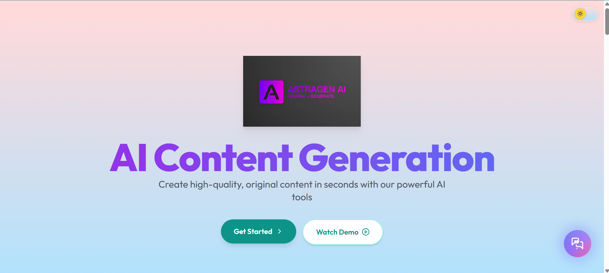
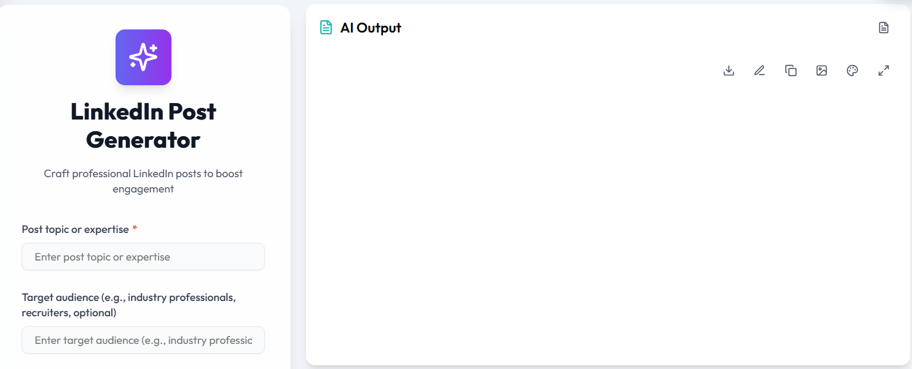
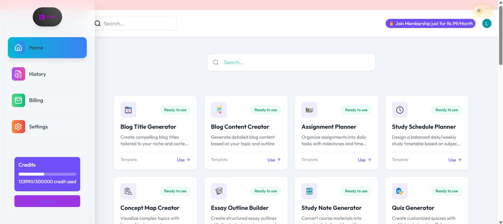
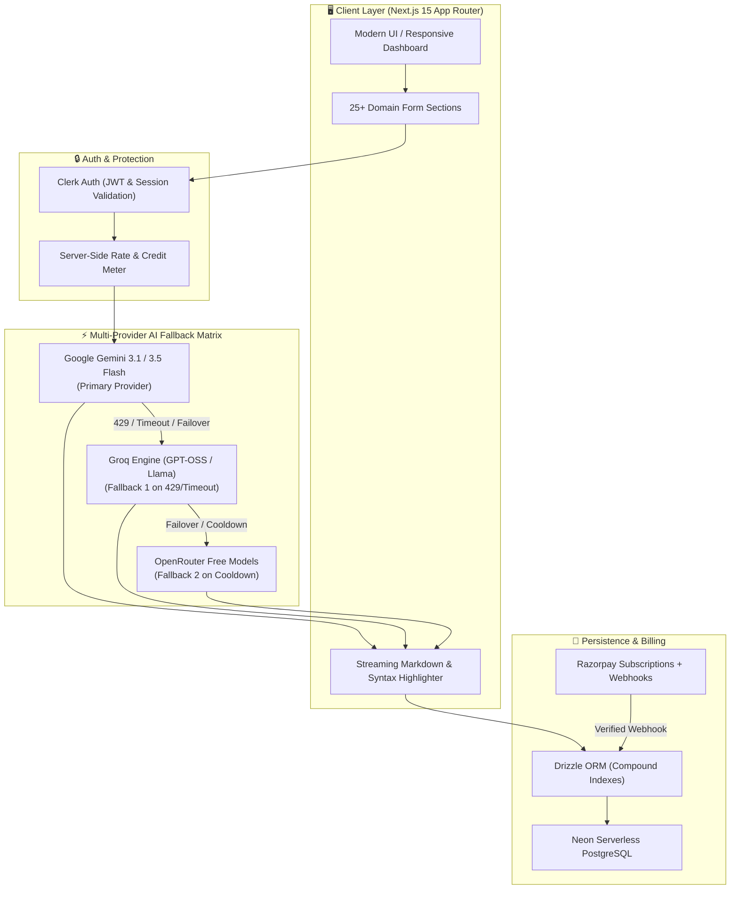

<div align="center">

<!-- Hero Banner -->


<!-- Animated Dynamic Typing Headline -->
<h2>
  <a href="https://readme-typing-svg.demolab.com">
    
  </a>
</h2>

<p align="center">
  <strong>The all-in-one, enterprise-grade AI content generation workstation.</strong><br/>
  Featuring multi-provider resilience (Google Gemini 3.x, Groq & OpenRouter fallback), real-time markdown streaming, automated credit tracking, and seamless SaaS subscription billing.
</p>

<!-- Badges Grid -->
<p align="center">
  <a href="https://github.com/Codewith-Yush/ASTRAGEN-AI/stargazers">
    
  </a>
  <a href="https://github.com/Codewith-Yush/ASTRAGEN-AI/network/members">
    
  </a>
  <a href="https://github.com/Codewith-Yush/ASTRAGEN-AI/issues">
    
  </a>
  <a href="LICENSE">
    
  </a>
</p>

<!-- Tech Badges -->
<p align="center">
  
  
  
  
  
  
  
  
  
</p>

<!-- Quick Navigation Bar -->
<p align="center">
  <a href="#-overview"><b>Overview</b></a> •
  <a href="#-live-showcase"><b>Live Showcase</b></a> •
  <a href="#-key-features"><b>Key Features</b></a> •
  <a href="#-system-architecture"><b>Architecture</b></a> •
  <a href="#-25-ai-generation-templates"><b>AI Templates</b></a> •
  <a href="#-tech-stack"><b>Tech Stack</b></a> •
  <a href="#-getting-started"><b>Quick Start</b></a> •
  <a href="#-environment-configuration"><b>Env Variables</b></a> •
  <a href="#-roadmap"><b>Roadmap</b></a>
</p>

</div>

---

## 🌟 Overview

**AstraGen AI** is a production-grade SaaS application designed to empower creators, developers, marketers, and researchers with AI-driven content acceleration. 

Unlike traditional wrappers that break during API rate spikes, AstraGen AI features a **multi-provider failover engine** with intelligent cooldown management: requests seamlessly fall back across **Google Gemini**, **Groq**, and **OpenRouter** without interrupting the user experience.

Combined with **Neon Serverless PostgreSQL**, **Drizzle ORM**, **Clerk v7 Authentication**, and **Razorpay Subscriptions**, AstraGen AI is a complete, scalable SaaS blueprint.

### 💡 Why AstraGen AI?

| Problem in Standard AI Tools | The AstraGen AI Solution |
| :--- | :--- |
| **API Outages & 429 Rate Limits** | Automatic 3-tier cascade (`Gemini 3.x` ➡️ `Groq` ➡️ `OpenRouter`) ensures **99.9% uptime**. |
| **Generic & Hallucinatory Output** | 25+ domain-specialized templates with fine-tuned system instructions and structured schemas. |
| **Static, Boring Generation** | Real-time streaming markdown renderer with syntax highlighting, word counters, and live refinement. |
| **Complex Billing Integration** | Built-in Razorpay subscription checkout with cryptographically verified webhook handlers. |
| **Lack of Usability History** | Persistent Neon PostgreSQL content archive with instant keyword search, copy, and export options. |

---

## 📱 Live Showcase

<div align="center">

### 🎬 Interactive Workflow Demo
*Experience the speed and fluidity of AstraGen AI in action.*

<br/>


</div>

<br/>

### 🖥️ Application Screen Previews

<div align="center">
<table width="100%">
  <tr>
    <td width="33.3%" align="center" valign="top">
      <h4>🌐 Neo-Brutalist Landing</h4>
      
      <p align="center"><sub>Framer Motion animations, Lenis smooth scroll & live playground</sub></p>
    </td>
    <td width="33.3%" align="center" valign="top">
      <h4>⚡ AI Content Generator</h4>
      
      <p align="center"><sub>Streaming AI responses, markdown editor & dynamic prompt tools</sub></p>
    </td>
    <td width="33.3%" align="center" valign="top">
      <h4>📚 History & Credit Hub</h4>
      
      <p align="center"><sub>Searchable records, word counter, export options & usage meters</sub></p>
    </td>
  </tr>
</table>
</div>

---

## 🏗️ System Architecture

AstraGen AI implements a resilient, serverless-first data flow designed for maximum throughput and fault tolerance:



---

## 🚀 Key Features

<table>
  <tr>
    <td width="50%" valign="top">
      <h3>🛡️ Multi-Provider Zero-Downtime AI</h3>
      <ul>
        <li><b>3-Tier Automated Fallback:</b> Automatically shifts from Google Gemini 3.x to Groq and OpenRouter on rate limits, errors, or timeouts.</li>
        <li><b>Dynamic Cooldowns:</b> Temporarily isolates failing models to prevent cascading bottlenecks.</li>
        <li><b>Output Token Optimization:</b> Dynamically allocates up to 16,384 tokens for long-form essays, quizzes, and code.</li>
      </ul>
    </td>
    <td width="50%" valign="top">
      <h3>🎯 25+ Curated Generation Templates</h3>
      <ul>
        <li><b>Domain-Tuned Prompts:</b> Purpose-built for blogs, social threads, YouTube, code review, academic essays, and marketing.</li>
        <li><b>Dynamic Form Controls:</b> Type-safe input validations, custom text areas, dropdowns, and target audience selectors.</li>
        <li><b>One-Click Regeneration:</b> Fine-tune generated content with quick sample injection.</li>
      </ul>
    </td>
  </tr>
  <tr>
    <td width="50%" valign="top">
      <h3>🪄 Interactive Content Refinement</h3>
      <ul>
        <li><b>Quick Actions Toolbar:</b> Improve clarity, expand paragraphs, condense summaries, or adjust tone in one click.</li>
        <li><b>Rich Markdown Viewer:</b> Formats tables, lists, blockquotes, and syntax-highlighted code blocks cleanly.</li>
        <li><b>Multi-Format Export:</b> Copy raw markdown, download plain <code>.txt</code>, <code>.md</code>, or print-ready formatted outputs.</li>
      </ul>
    </td>
    <td width="50%" valign="top">
      <h3>💳 SaaS Monetization & Usage Tracking</h3>
      <ul>
        <li><b>Usage Credit Tracker:</b> Real-time visual progress bar tracking word counts against user quotas (e.g. 10,000 Free words).</li>
        <li><b>Razorpay Subscriptions:</b> Seamless recurring subscription checkout with instant activation.</li>
        <li><b>Cryptographic Webhook Handlers:</b> Idempotent transaction logging with HMAC SHA-256 signature verification.</li>
      </ul>
    </td>
  </tr>
  <tr>
    <td width="50%" valign="top">
      <h3>🔐 Authentication & Server Security</h3>
      <ul>
        <li><b>Clerk Auth Integration:</b> Secure social logins (Google, GitHub, Email) with route protection middleware.</li>
        <li><b>Server-Only Credential Isolation:</b> Zero exposure of AI provider keys or database secrets to client bundles.</li>
        <li><b>DOMPurify Sanitization:</b> Client-side HTML scrubbing to prevent cross-site scripting (XSS).</li>
      </ul>
    </td>
    <td width="50%" valign="top">
      <h3>⚡ Performance & Modern UX</h3>
      <ul>
        <li><b>Next.js 15 & React 19:</b> Accelerated with Turbopack, Server Components, and optimized bundle splits.</li>
        <li><b>Fluid Neo-Brutalist Aesthetic:</b> Bold borders, deep drop shadows, Framer Motion springs, and Lenis smooth scrolling.</li>
        <li><b>SWR Data Revalidation:</b> Background cache revalidation for snappy dashboard interactions.</li>
      </ul>
    </td>
  </tr>
</table>

---

## 📂 25+ AI Generation Templates

AstraGen AI comes bundled with a comprehensive catalog of industry-grade templates:

<details open>
<summary><b>📚 Click to expand the full template directory</b></summary>

<br/>

| Category | Template Name | Description | Key Inputs |
| :--- | :--- | :--- | :--- |
| **✍️ Editorial & Blog** | `blog-title-generator` | Viral, SEO-optimized headlines tailored to your niche | Niche, Outline |
| | `blog-content-creator` | Comprehensive long-form blog articles with structured sections | Topic, Outline |
| | `article-rewriter` | Plagiarism-free content rewriter with improved vocabulary | Source Article |
| | `essay-outline-builder` | Academic essay blueprints with citation structure | Topic, Points, Citation Style |
| **🎓 Academics & Study** | `study-note-generator` | High-retention study notes & Cornell summaries | Course Content, Subject |
| | `comprehensive-quiz-generator` | Multiple choice & open-ended exam questions | Material, Types, Count |
| | `concept-map-creator` | Conceptual hierarchy maps & mind-map relations | Topic, Complexity, Field |
| | `assignment-planner` | Milestone breakdown & scheduled daily study steps | Details, Deadline, Hours |
| | `study-schedule-planner` | Balanced timetable according to available hours | Subjects, Schedule, Target |
| | `case-study-generator` | Real-world problem scenarios with analysis questions | Field, Topic, Ethics |
| | `research-paper-analyzer` | Deep breakdown of methodologies, findings & limitations | Paper Text, Audience Level |
| | `language-drill-generator` | Grammar drills, vocabulary & conversational exercises | Source, Native/Target Lang |
| **📱 Social Media & Growth** | `youtube-description-generator`| High-CTR YouTube descriptions with timestamps & tags | Video Topic, Outline |
| | `youtube-tag-generator` | Algorithmic metadata tags for higher search rank | Video Title, Outline |
| | `youtube-shorts-script-generator` | High-retention 60-second scripts with visual cues | Shorts Topic, Target Audience |
| | `linkedin-post-generator` | Professional thought leadership & career story posts | Topic, Audience, Key Points |
| | `linkedin-profile-optimizer` | Profile headlines, About summaries & experience copy | Job Title, Industry, Goals |
| | `instagram-post-generator` | Aesthetic captions with hooks and calls-to-action | Keywords, Tone |
| | `instagram-hashtag-generator` | Low, medium & high competition viral hashtag sets | Keywords |
| | `instagram-content-idea-generator` | Multi-day content calendar ideas & carousel concepts | Brand Niche, Keywords |
| | `viral-tweet-thread-creator` | High-engagement Twitter/X threads engineered for shares | Core Topic, Perspective |
| **💻 Code & Dev Tools** | `code-generator` | Clean, production-ready code in any programming language | Feature Description |
| | `code-explainer` | Step-by-step logic breakdown & time complexity analysis | Source Code |
| | `code-bug-detector` | Static vulnerability detection & automated bug fixes | Buggy Code Input |
| **💼 Business & Marketing**| `product-description-generator` | Persuasive eCommerce sales copy highlighting benefits | Product Name, Features |
| | `tagline-generator` | Memorable branding slogans & high-impact taglines | Brand Name, Value Prop |
| | `seo-content-optimizer` | Keyword density analysis & organic search recommendations| Content, Target Keywords |
| | `podcast-episode-planner` | Host intros, discussion questions & guest segments | Topic, Genre, Guest Info |
| | `meeting-agenda-creator` | Timed discussion agenda with clear action items | Purpose, Topics, Duration |
| | `multi-platform-repurposer` | Turn one piece of content into 5 platform formats | Source Content, Platforms |
| **🎨 Prompt Engineering** | `ai-image-prompt-generator` | Hyper-detailed prompts for Midjourney, DALL-E 3 & SDXL | Subject, Style, Engine |
| | `ai-prompt-engineer` | Meta-prompts engineered for maximum LLM performance | Target Goal, System Rules |

</details>

---

## 🛠️ Tech Stack

<div align="center">

| Area | Technologies |
| :--- | :--- |
| **Frontend Framework** | `Next.js 15.3` (App Router) • `React 19.3` • `TypeScript 5` |
| **Styling & Motion** | `Tailwind CSS 3.4` • `Framer Motion 12` • `Lenis Smooth Scroll` • `Lucide Icons` |
| **AI Inference** | `Google Generative AI SDK` (Gemini 3.x) • `Groq API` • `OpenRouter API` |
| **Database & ORM** | `Neon Serverless PostgreSQL 18` • `Drizzle ORM 0.45` • `Drizzle Kit 0.31` |
| **Auth & Security** | `Clerk v7` • `DOMPurify` • `Zod Schema Validation` • `Server-Only Secrets` |
| **Payments & Monetization** | `Razorpay SDK` • `HMAC SHA-256 Webhook Verification` |
| **Quality & Testing** | `Vitest 3` • `React Testing Library` • `Storybook 8` • `ESLint` |

<br/>


</div>

---

## 🏁 Getting Started

Follow these steps to set up AstraGen AI locally in minutes.

### 📋 Prerequisites

- **Node.js**: `v18.17.0` or higher (Node 20+ recommended)
- **Package Manager**: `npm`, `pnpm`, or `yarn`
- **Neon Account**: Free serverless Postgres database at [neon.tech](https://neon.tech)
- **Clerk Account**: Free authentication setup at [clerk.com](https://clerk.com)
- **Google Gemini API Key**: Free API key from [Google AI Studio](https://aistudio.google.com/)

### ⚡ Quick Installation

```bash
# 1. Clone the repository
git clone https://github.com/Codewith-Yush/ASTRAGEN-AI.git

# 2. Enter project directory
cd ASTRAGEN-AI

# 3. Install dependencies
npm install

# 4. Create your local environment file
cp .env.example .env.local

# 5. Push schema to your Neon PostgreSQL database
npm run db:push

# 6. Launch the development server
npm run dev
```

Open [http://localhost:3000](http://localhost:3000) in your browser to start creating.

---

## 🔐 Environment Configuration

Create a `.env.local` file in the root directory and configure the following keys:

```ini
# ==========================================
# 🗄️ DATABASE (Neon Serverless PostgreSQL)
# ==========================================
DATABASE_URL=postgresql://<user>:<password>@<ep-xyz>.neon.tech/neondb?sslmode=require

# ==========================================
# 🔒 AUTHENTICATION (Clerk)
# ==========================================
NEXT_PUBLIC_CLERK_PUBLISHABLE_KEY=pk_test_...
CLERK_SECRET_KEY=sk_test_...
NEXT_PUBLIC_CLERK_SIGN_IN_URL=/sign-in
NEXT_PUBLIC_CLERK_SIGN_UP_URL=/sign-up
NEXT_PUBLIC_CLERK_SIGN_IN_FALLBACK_REDIRECT_URL=/dashboard
NEXT_PUBLIC_CLERK_SIGN_UP_FALLBACK_REDIRECT_URL=/dashboard

# ==========================================
# 🧠 AI ENGINE (Multi-Provider Setup)
# ==========================================
# Primary Provider: Google Gemini
GEMINI_API_KEY=your_gemini_api_key_here
GEMINI_MODEL=gemini-3.1-flash-lite

# Fallback Provider 1: Groq (Optional, highly recommended)
GROQ_API_KEY=your_groq_api_key_here
GROQ_MODEL=openai/gpt-oss-120b,openai/gpt-oss-20b

# Fallback Provider 2: OpenRouter (Optional free models)
OPENROUTER_API_KEY=your_openrouter_api_key_here
OPENROUTER_MODEL=google/gemma-4-31b-it:free,openrouter/free

# Provider Execution Order
AI_PROVIDER_ORDER=gemini,groq,openrouter

# ==========================================
# 💳 PAYMENTS & BILLING (Razorpay)
# ==========================================
NEXT_PUBLIC_RAZORPAY_KEY_ID=rzp_test_...
RAZORPAY_KEY_ID=rzp_test_...
RAZORPAY_SECRET_KEY=your_razorpay_secret
RAZORPAY_WEBHOOK_SECRET=your_webhook_secret
SUBSCRIPTION_PLAN_ID=plan_...

# ==========================================
# 📧 EMAIL SMTP (Nodemailer Support Form)
# ==========================================
EMAIL_HOST=smtp.gmail.com
EMAIL_PORT=587
EMAIL_SECURE=false
EMAIL_USER=your_email@gmail.com
EMAIL_PASSWORD=your_app_specific_password
CONTACT_RECEIVER_EMAIL=support@astragen.ai
```

---

## 📜 Database & Tooling Scripts

| Command | Description |
| :--- | :--- |
| `npm run dev` | Starts Next.js development server on `localhost:3000` |
| `npm run dev:turbo` | Starts development server with experimental Turbopack |
| `npm run build` | Builds optimized production bundle |
| `npm run typecheck` | Validates TypeScript types across the entire project (`tsc --noEmit`) |
| `npm run lint` | Runs ESLint checks |
| `npm run test` | Executes unit and security tests via Vitest |
| `npm run db:push` | Pushes Drizzle ORM schema directly to Neon Postgres |
| `npm run db:studio` | Opens visual Drizzle Studio database manager |
| `npm run storybook` | Launches Storybook component explorer on `localhost:6006` |

---

## 📁 Project Directory Structure

```text
ASTRAGEN-AI/
├── app/
│   ├── (auth)/                  # Clerk Sign-In & Sign-Up routes
│   │   ├── sign-in/[[...sign-in]]/
│   │   └── sign-up/[[...sign-up]]/
│   ├── (data)/                  # Shared template exports
│   ├── (context)/               # React contexts (TotalUsage, CreditContext)
│   ├── api/                     # Backend API handlers
│   │   ├── content/route.ts     # Core AI generation endpoint
│   │   ├── refine/route.ts      # Fast AI refinement endpoint
│   │   ├── create-subscription/ # Razorpay checkout session handler
│   │   ├── razorpay-webhook/    # Idempotent webhook receiver
│   │   └── contact/route.ts     # SMTP contact email sender
│   ├── dashboard/               # User dashboard interface
│   │   ├── billing/             # Subscription tiers & Razorpay triggers
│   │   ├── content/[slug]/      # Interactive generation workbench
│   │   ├── history/             # Generation archives & search
│   │   ├── settings/            # Clerk user profile controls
│   │   └── _components/         # SideNav, Header, UsageTrack, Search
│   ├── layout.tsx               # Root application layout
│   └── page.tsx                 # Neo-brutalist landing page
├── components/                  # Shared UI components (Navbar, Footer, Lenis)
├── data/                        # 25+ Template definitions & prompt schemas
├── drizzle/                     # SQL migration files & schema snapshots
├── lib/                         # Type-safe environment & utility configs
├── public/                      # Static assets, screenshots & demo graphics
├── utils/                       # DB client, Drizzle schema & Multi-provider AI modal
├── drizzle.config.js            # Drizzle Kit configuration
└── package.json                 # Project dependencies & scripts
```

---

## 🗺️ Roadmap & Milestones

- [x] **v1.0**: Core Next.js 15 App Router architecture with Tailwind CSS
- [x] **v1.2**: 25+ Domain-specific AI templates with structured inputs
- [x] **v1.4**: Neon Serverless PostgreSQL integration via Drizzle ORM
- [x] **v1.6**: Clerk v7 Social Authentication & Protected Dashboards
- [x] **v1.8**: Razorpay recurring subscription tiers & cryptographic webhooks
- [x] **v2.0**: **Multi-Provider AI Fallback Engine** (Gemini ➡️ Groq ➡️ OpenRouter)
- [ ] **v2.2**: Direct 1-Click CMS & Social Publishing (WordPress, Dev.to, Medium, X)
- [ ] **v2.4**: Multi-user Team Workspaces & Shared Asset Libraries
- [ ] **v2.6**: Custom Brand Voice & Style Fine-Tuning Profiles
- [ ] **v2.8**: Multimodal Generation (AI Image Generation & Audio-to-Article transcription)

---

## 🤝 Contributing

Contributions make the open-source community an inspiring place to learn, create, and innovate. Any contributions you make are **greatly appreciated**.

1. **Fork** the Project
2. Create your Feature Branch (`git checkout -b feature/AmazingFeature`)
3. Commit your Changes (`git commit -m 'Add some AmazingFeature'`)
4. Push to the Branch (`git push origin feature/AmazingFeature`)
5. Open a **Pull Request**

---

## 📄 License

Distributed under the **MIT License**. See [`LICENSE`](LICENSE) for more information.

---

## 📬 Author & Community

<div align="center">

Developed with ❤️ by **Ayush**

<br/>

<a href="https://github.com/Codewith-Yush">
  
</a>
&nbsp;
<a href="mailto:ayushsingh7360@gmail.com">
  
</a>
&nbsp;
<a href="https://github.com/Codewith-Yush/ASTRAGEN-AI/stargazers">
  
</a>

<br/><br/>

### ⭐ Show your support
If you find AstraGen AI helpful or inspiring, please give it a **Star** on GitHub!

<br/>

<a href="https://github.com/Codewith-Yush/ASTRAGEN-AI">
  
</a>

<br/><br/>


</div>
