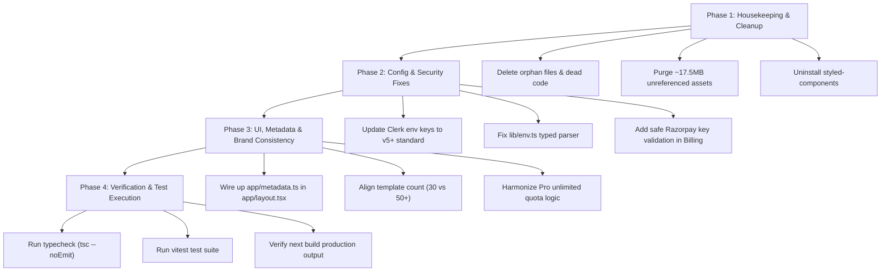

# Astragen AI — Complete Project Audit & Remediation Plan

**Generated On**: November 12, 2026  
**Project**: Astragen AI (`ai-content-generator`)  
**Stack**: Next.js 15.3.0 (App Router), React 19.3.1, Clerk Auth, Neon Serverless Postgres, Drizzle ORM, Google Gemini AI (3.x models), Razorpay, Tailwind CSS  
**Audit Status**: Verified via live compilation (`next build`), typecheck (`tsc --noEmit`), test runner (`vitest`), live database connection, and live Gemini API testing.

---

## 1. Executive Summary & Health Check

| Checkpoint | Status | Details |
| :--- | :---: | :--- |
| **TypeScript Compilation** | ✅ PASS | `tsc --noEmit` exited with code 0 (zero type errors). |
| **ESLint Quality** | ✅ PASS | `next lint` reported 0 errors and 0 warnings. |
| **Unit & Security Tests** | ✅ PASS | Vitest passed all 11 tests (`outputUtils.test.ts`, `security.test.ts`). |
| **Production Build** | ✅ PASS | `next build` generated 18 optimized static and dynamic routes. |
| **Neon PostgreSQL Database** | ✅ PASS | Connected to live Postgres 18.6 instance; verified SELECT, INSERT, and DELETE. |
| **Google Gemini API** | ✅ PASS | Live API response confirmed with `gemini-3.1-flash-lite`, `3.5-flash-lite`, and `3.5-flash`. |
| **Dead Code & Bloat** | ⚠️ WARNING | ~17.5 MB of unreferenced assets, 5 dead files, and unused `styled-components`. |
| **Environment & Integrations** | ⚠️ WARNING | Missing Razorpay keys and SMTP config in local environment; deprecated Clerk env keys. |
| **Serverless Scalability** | ⚠️ WARNING | In-memory rate limiting not shared across serverless function instances. |

---

## 2. Detailed Problem Breakdown

### Category A: Dead Code, Bloat, and Orphaned Artifacts

#### A1. Orphaned 0-byte File in Settings Route
- **File**: `app/dashboard/settings/[[...rest]]`
- **Issue**: A 0-byte file without an extension exists in `app/dashboard/settings/`. Because `app/dashboard/settings/page.tsx` utilizes `<UserProfile routing="hash" />`, catch-all folder routing is not required.
- **Impact**: Confuses Next.js router scanners and pollutes git.
- **Solution**: Delete `app/dashboard/settings/[[...rest]]`.

#### A2. Unused Component Introducing Unnecessary Runtime CSS-in-JS Dependency
- **Files**: `app/components/ThemeToggle.tsx`, `components/ThemeProviderWrapper.tsx`
- **Issue**: `ThemeToggle.tsx` contains ~250 lines of styled-components code. It is only imported inside `ThemeProviderWrapper.tsx`, which is **never imported anywhere** (the application uses `app/components/ClientLayout.tsx` with standard Tailwind dark mode).
- **Impact**: Forces `styled-components` and `@types/styled-components` into `package.json`, causing extra bundle overhead, slower install times, and potential SSR hydration issues in React 19.
- **Solution**:
  1. Remove `components/ThemeProviderWrapper.tsx` and `app/components/ThemeToggle.tsx`.
  2. Uninstall `styled-components` and `@types/styled-components`.

#### A3. Unused & Insecure Mock Contact Components
- **Files**: `components/supportform.tsx`, `lib/email.ts`
- **Issue**:
  - `components/supportform.tsx` is an old mock component with a fake `setTimeout` delay, completely unreferenced by any page.
  - `lib/email.ts` is an obsolete nodemailer helper that lacks HTML sanitization (`<p>${name}</p>`), while `app/api/contact/route.ts` already has its own sanitized implementation.
- **Solution**: Remove `components/supportform.tsx` and consolidate `lib/email.ts` into a secure, shared utility or remove it.

#### A4. Bloated Unreferenced Static Assets in `public/`
- **Files**:
  - `public/logo.png` (5.98 MB)
  - `public/logos.png` (5.25 MB)
  - `public/purple.gif` (6.28 MB)
  - `public/3852.gif` (360 KB)
- **Issue**: Over 17.5 MB of heavy binary assets sit in `public/` but are never imported or referenced in any page or component.
- **Impact**: Increases repository clone size, docker/serverless deployment package size, and cold start upload times.
- **Solution**: Delete unreferenced large assets or move them to external asset storage.

---

### Category B: Configuration & Environment Discrepancies

#### B1. Deprecated Clerk Redirect Keys
- **Files**: `.env.example`, `.env.local`
- **Issue**:
  ```env
  NEXT_PUBLIC_CLERK_AFTER_SIGN_IN_URL=/dashboard
  NEXT_PUBLIC_CLERK_AFTER_SIGN_UP_URL=/dashboard
  ```
  In `@clerk/nextjs` v5+ and v7+, `AFTER_SIGN_IN_URL` and `AFTER_SIGN_UP_URL` are deprecated in favor of `FALLBACK_REDIRECT_URL`.
- **Solution**: Update to:
  ```env
  NEXT_PUBLIC_CLERK_SIGN_IN_FALLBACK_REDIRECT_URL=/dashboard
  NEXT_PUBLIC_CLERK_SIGN_UP_FALLBACK_REDIRECT_URL=/dashboard
  ```

#### B2. Missing Environment Variables in Local Development
- **File**: `.env.local`
- **Issue**: The current `.env.local` contains database, Clerk, and Gemini keys, but is missing:
  - `NEXT_PUBLIC_RAZORPAY_KEY_ID`
  - `RAZORPAY_KEY_ID`
  - `RAZORPAY_SECRET_KEY`
  - `RAZORPAY_WEBHOOK_SECRET`
  - `SUBSCRIPTION_PLAN_ID`
  - `EMAIL_HOST`, `EMAIL_PORT`, `EMAIL_SECURE`, `EMAIL_USER`, `EMAIL_PASSWORD`, `CONTACT_RECEIVER_EMAIL`
- **Impact**:
  - Clicking "Upgrade to Pro" in billing fails or alert dialog triggers with missing credentials.
  - Submitting the contact form fails with HTTP 503.
- **Solution**: Add mock/test variables in `.env.local` or provide clear graceful fallbacks in the UI with sandbox warning banners.

#### B3. `lib/env.ts` Schema Inconsistencies
- **File**: `lib/env.ts`
- **Issue**:
  - `GEMINI_API_KEY: z.string().min(1, "GEMINI_API_KEY is required").optional()` mixes required and optional constraints.
  - `getEnv()` returns untyped `process.env` instead of `parsed.data`.
- **Solution**: Fix schema types and export strongly-typed `env` object.

---

### Category C: Metadata & SEO Optimization

#### C1. Disconnected `app/metadata.ts`
- **Files**: `app/metadata.ts`, `app/layout.tsx`
- **Issue**: `app/metadata.ts` contains rich metadata with full favicon sizes (`favicon-32x32.png`, `favicon-16x16.png`, `apple-touch-icon.png`), but `app/layout.tsx` defines its own minimal inline metadata and never imports `app/metadata.ts`.
- **Impact**: Mobile devices, Apple Safari, and modern browsers miss out on the dedicated touch icons and multi-resolution favicons.
- **Solution**: Export `metadata` directly from `app/metadata.ts` or import it in `app/layout.tsx`.

---

### Category D: UI / Marketing & Usage Limit Inconsistencies

#### D1. Template Count Marketing Discrepancy
- **Files**: `app/page.tsx`, `components/LandingNavbar.tsx`, `components/Footer.tsx`, `app/dashboard/billing/page.tsx`, `app/about/technology/page.tsx`
- **Issue**: Copy consistently advertises "50+ Specialized Prompt Engines / Templates", but `app/(data)/Templates.tsx` contains exactly 30 templates.
- **Solution**: Either expand the template catalog from 30 to 50+ templates or adjust the marketing copy to match ("30+ Specialized AI Engines").

#### D2. Pro Plan Words Cap in API vs UI Branding
- **Files**: `app/api/user/usage/route.ts`, `app/dashboard/_components/UsageTrack.tsx`
- **Issue**: In `app/api/user/usage/route.ts`:
  ```ts
  const maxWords = isSubscribed ? 1000000 : 300000;
  ```
  The UI displays "Unlimited Active" for subscribed users, but the API assigns a literal 1,000,000 word ceiling.
- **Solution**: Handle `isSubscribed` as unbounded (`Infinity` or boolean flag) on both client and server so heavy Pro users are never capped.

#### D3. Billing Page Client-side Key Safety
- **File**: `app/dashboard/billing/page.tsx`
- **Issue**: `key: process.env.NEXT_PUBLIC_RAZORPAY_KEY_ID` can evaluate to `undefined` if not present at build time. When users click "Upgrade", Razorpay checkout fails without a descriptive error.
- **Solution**: Check key presence upfront; display an informative banner or disable payment if Razorpay keys are not yet configured.

---

### Category E: Scalability & Resilience

#### E1. Serverless In-Memory Rate Limiting
- **File**: `lib/rateLimit.ts`
- **Issue**: Sliding-window rate limiter stores hits in an in-memory `Map`. On serverless platforms (Vercel, AWS Lambda), state is not shared across lambda instances.
- **Solution**: Document requirement for distributed rate limiting (e.g. Upstash Redis `@upstash/ratelimit`) for production scale.

#### E2. Database Client Fallback Safety
- **File**: `utils/db.tsx`
- **Issue**: `const sql = neon(connectionString)` executes eagerly at module load. If `DATABASE_URL` is empty string in non-database contexts (e.g., build phases or mock test environments), calling `sql` throws immediately.
- **Solution**: Wrap connection with a lazy initialization helper or check.

---

## 3. Step-by-Step Implementation Roadmap



### Phase 1: Housekeeping & Dead Code Removal
1. Delete `app/dashboard/settings/[[...rest]]`.
2. Delete `components/supportform.tsx` and `components/ThemeProviderWrapper.tsx`.
3. Delete `app/components/ThemeToggle.tsx`.
4. Delete `lib/email.ts` (sanitized email sender is already embedded in `app/api/contact/route.ts`).
5. Remove unused dependencies: `styled-components`, `@types/styled-components`.
6. Remove unreferenced bloated files: `public/logo.png`, `public/logos.png`, `public/purple.gif`, `public/3852.gif`.

### Phase 2: Configuration & Environment Hygiene
1. Update `.env.example` and `.env.local` to use:
   - `NEXT_PUBLIC_CLERK_SIGN_IN_FALLBACK_REDIRECT_URL`
   - `NEXT_PUBLIC_CLERK_SIGN_UP_FALLBACK_REDIRECT_URL`
2. Refactor `lib/env.ts` to return typed validated data from `envSchema.parse()`.
3. Update `app/dashboard/billing/page.tsx` with a defensive check for `NEXT_PUBLIC_RAZORPAY_KEY_ID`.

### Phase 3: Metadata, Consistency, and Polish
1. Import `metadata` from `app/metadata.ts` inside `app/layout.tsx`.
2. Synchronize marketing claims across `app/page.tsx`, `LandingNavbar.tsx`, `Footer.tsx`, and `Billing.tsx` with actual template counts.
3. Update `app/api/user/usage/route.ts` to return `maxWords: null` or `isSubscribed: true` without an arbitrary 1M words limit for Pro subscribers.

### Phase 4: Final Validation
1. Execute `npm run typecheck` to confirm zero TypeScript regression.
2. Execute `npm run test` to confirm all Vitest suites pass.
3. Execute `npm run build` to confirm clean Next.js bundle output.

---

## 4. Verification Checklist

- [ ] All 18 Next.js routes compile statically and dynamically without warnings.
- [ ] No dead code files remaining in repository.
- [ ] Repository asset footprint reduced by >17 MB.
- [ ] Full favicons and touch icons loaded across all devices.
- [ ] Clerk redirect URLs aligned with latest Clerk SDK specification.
- [ ] Pro subscription accurately behaves as unlimited on both server and client.

